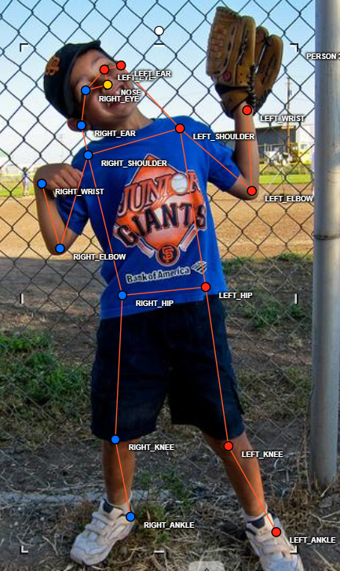
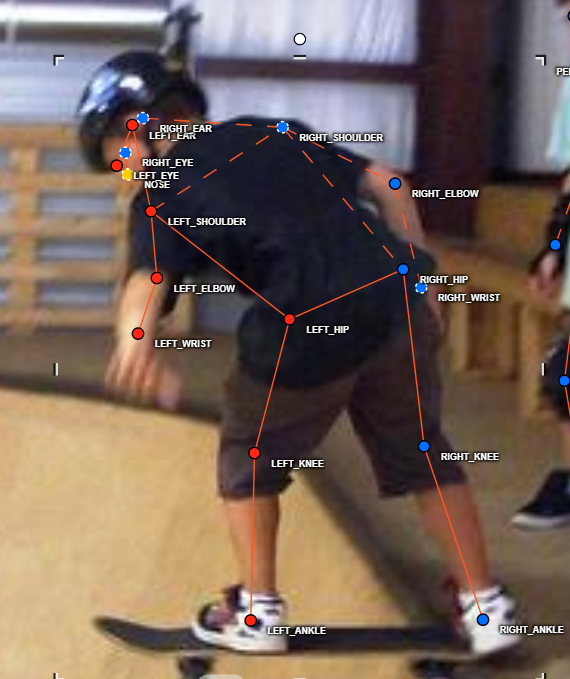
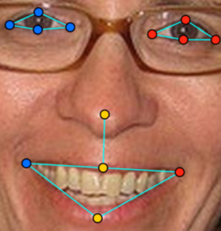
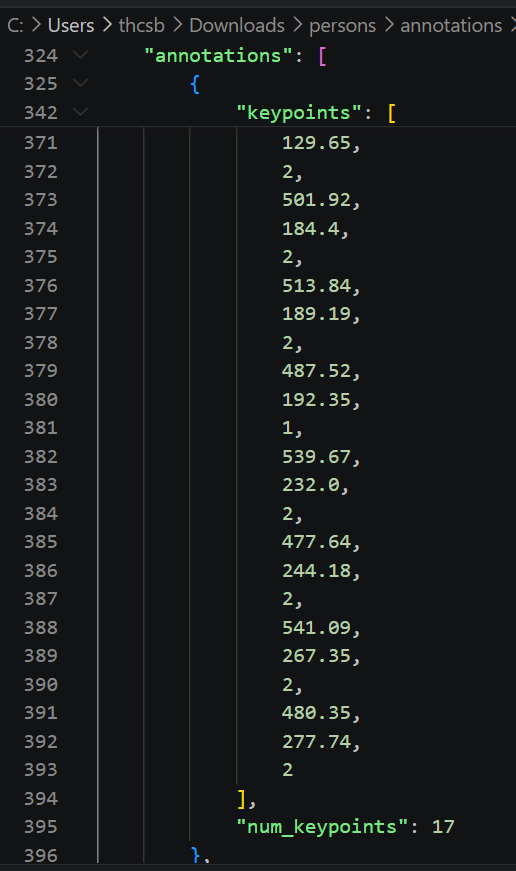

# Báo cáo cá nhân — PhamVanDuong-2A202603332

Đổi tên file theo quy tắc `MSSV_HoTen.md`. Ví dụ: `20241234_NguyenVanAn.md`.

Dữ liệu: 12 ảnh người COCO val2017 (Lin et al., 2014) và 8 ảnh chân dung Wikimedia Commons, chỉ dùng trong lớp.

## 0. Thông tin học viên

- Họ tên: Phạm Văn Dương
- MSSV:2A202603332
- Email:26ai.duongpv@vinuni.edu.vn
- Link repository:https://github.com/pvd2201/K5-L2B-DAY04-PhamVanDuong-2A202603332-KeypointPose.git
- Phiên bản CVAT (Help → About): 2.74.1
- Máy: hệ điều hành Windows · RAM 16 GB · chạy CVAT chế độ đầy đủ
- Bộ ảnh (`src/exports/assignment.json` do `lab.py setup` tạo): có
- Giờ bắt đầu: 16:45
- Giờ kết thúc: 19:00

## 1. Kiểm tra label (CP0)

| Label | Kiểu | Số điểm | Tên điểm đúng bảng của lab? | Đúng thứ tự? | Số cạnh |
|---|---|---:|---|---|---:|
| `person` |Skeleton |17 |Có |Có |19 |
| `face` |Skeleton |13 |Có|Có |13|

Mẫu `person` dựng theo người quay mặt về camera (các điểm `left_*` nằm bên phải khung mẫu)? Có 

Cách đổi cờ `occluded` / `outside` cho **một điểm** trên phiên bản CVAT này:
Ấn phím G để bật/tắt Occluded, ấn phím O để bật/tắt Outside
...

## 2. Số lượng đã gán và thời gian (CP1, CP2)

| Nhóm ảnh | Số ảnh | Số skeleton đã gán | Số người dưới 60 px (không gán) | Số poster / gương / màn hình bỏ qua | Thời gian (phút) |
|---|---:|---:|---:|---:|---:|
| `easy` | 5 |6 |0 |0 |24 |
| `occluded` | 3 | 7|0 |0 |24 |
| `back` | 2 | 4 | 0 | 0 | 14 |
| `small` | 1 |0 |0 | 0| 8|
| `crowd` | 1 | 2 | 10 | 0 | 10 |
| `faces` | 8 |8 | 0 | 0|15 |

- Số ảnh người đã xong ở mốc phút 105: 10 / 10
- Thời gian thực tế (phút): CP1 _80__ · CP2 _15__ · CP3 _20__


- Ảnh tốn thời gian nhất là ảnh nào, vì sao?

Ảnh tốn thời gian nhất là ảnh 000000272026.jpg, vì phải gán nhãn cho 3 người. Trong khi đó, các tư thế ngồi của các nhân vật khá phức tạp, các điểm gán đều nằm ở vị trí khuất.

...

## 3. Bảng ca khó (CP1, CP2)

Mỗi điểm bạn phân vân một dòng, nhất là phân vân giữa `v = 1` và `v = 0`, hoặc không chắc hướng người.

| Ảnh | Người / mặt | Điểm | Cờ đã chọn | Phân vân giữa | Lý do chọn |
|---|---|---|---:|---|---|
|face_99874.jpg|mặt|8 điểm quanh mắt|v=1|v=1 và v=0|mắt bị che bởi kính râm, không thấy được vị trí chính xác để ước lượng|
|000000272026.jpg|người|LEFT_ELBOW của người áo đen (CVAT ID=145)|v=0|v=0 và v=1|phần khuỷu tay ra khỏi khung hình, nhưng cổ tay lại ở trong khung hình |
|000000463932.jpg|người|RIGHT_EYE|v=1|v=1 và v=0|không thấy mắt trong khung hình|

## 4. Bảng tự review (CP3)

Đi từ ảnh cuối về ảnh đầu. 5 ảnh người (ít nhất 2 ảnh `back` hoặc `crowd`) và 3 ảnh mặt. Ít nhất 8 dòng, kể cả dòng `ok`. Ghi lỗi trước, sửa sau.

Mã lỗi dùng đúng một trong: `lr_swap`, `vis_flag`, `position`, `missing`, `extra`, `ok`.

| Ảnh | Người / mặt | Điểm | Mã lỗi | Ghi chú | Đã sửa? |
|---|---|---|---|---|---|
|face_99874.jpg|mặt |8 điểm quanh mắt của người đeo kính râm |vis_flag |gán nhầm v=0 |gán lại v=1 |
|face_559185.jpg |mặt |ok |ok | Đã kiểm tra thứ tự trái/phải và vị trí 13 điểm| không cần|
| face_496353.jpg|mặt |ok |ok | Đã kiểm tra thứ tự trái/phải và vị trí 13 điểm| không cần|
| 000000518966.jpg|người |ok |ok |Vị trí điểm và visibility chính xác |không cần |
| 000000469061.jpg|người |left_elbow |vis_flag | Điểm bị che nhưng chưa bật Occluded|có |
|000000463932.jpg |người |ok |ok |Vị trí điểm và visibility chính xác |không cần |
|000000431988.jpg | người |left_shoulder/right_shoulder |lr_swap |Phát hiện hai keypoint trái – phải bị đảo vị trí; đã xác định lại theo góc nhìn của người được gán nhãn và hoán đổi về đúng bên. |có |
|000000431893.jpg | người |ok |ok |Vị trí điểm và visibility chính xác |không cần |

Tổng hợp số lỗi theo mã:

| `lr_swap` | `vis_flag` | `position` | `missing` | `extra` | `ok` |
|---:|---:|---:|---:|---:|---:|
| 1|2 |0 |0 |0 |5 |

Điểm còn phân vân giữa `v = 1` và `v = 0` (ghi cả hai lựa chọn và lý do chọn):
Những điểm mà cơ thể còn trong khung hình, tuy nhiên không thể ước lượng được vị trí.
...

## 5. Kiểm file xuất và kết quả tự kiểm (CP4)

Tự kiểm tay trong file JSON:

| File | Người / mặt kiểm (ảnh, thứ tự) | Số phần tử `keypoints` | Điểm `outside` ra `v = 0`, `occluded` ra `v = 1`? | `num_keypoints` khớp? |
|---|---|---:|---|---|
| `PhamVanDuong_persons.zip` |000000030960.jpg, Person 1 (id=4) |51 |có |có |
| `PhamVanDuong_persons.zip` | 	000000030960.jpg, Person 2 (id=5)| 51|có |có |
| `PhamVanDuong_faces.zip` | 	face_143959.jpg, Face 1 (id=1)|39 |không có điểm cần kiểm tra |có |

Sau khi xuất, CVAT ghi `occluded` thành `v = __1_` và `outside` thành `v = _0__`. Tọa độ của điểm `outside` trong file là `0, 0`, không phải tọa độ cũ.

Hai job đã chuyển sang completed trên CVAT? Có

Dán phần **TÓM TẮT** in ra từ `src/check_submission.py`:

```text
 File person: PhamVanDuong_persons.zip
  Số ảnh: 12 · số skeleton `person`: 20 · mỗi annotation 51 số
  Skeleton theo ảnh: 000000007281=2, 000000027565=1, 000000030960=2, 000000122199=2, 000000196283=1, 000000272026=3, 000000292999=1, 000000431893=1, 000000431988=2, 000000463932=1, 000000469061=2, 000000518966=2
  Cờ v: v=2 212 (62%) · v=1 87 (26%) · v=0 41 (12%)
  num_keypoints trung bình: 14.9
- File face: PhamVanDuong_faces.zip
  Số ảnh: 8 · số skeleton `face`: 8 · mỗi annotation 39 số
  Skeleton theo ảnh: face_143959=1, face_145621=1, face_185015=1, face_421231=1, face_490361=1, face_496353=1, face_559185=1, face_99874=1
  Cờ v: v=2 91 (88%) · v=1 13 (12%) · v=0 0 (0%)
  num_keypoints trung bình: 13.0
- Ghi chú: 41 điểm v = 0 vẫn mang tọa độ cũ (CVAT 2.x xuất như vậy; chuẩn COCO ghi 0, 0). Không phải lỗi: điểm v = 0 bị bỏ qua khi huấn luyện và khi chấm.
- Số [LỖI]: 0 · số [CẢNH BÁO]: 3
Kết quả: ĐẠT (đọc lại từng cảnh báo ở trên)
```

Các `[CẢNH BÁO]` còn giữ nguyên và lý do:
  [CẢNH BÁO] 000000272026.jpg #2: cặp wrist nằm ngược phía so với các cặp còn lại. Có thể đổi trái/phải một cặp (`lr_swap`), hoặc tay / chân bắt chéo thật: kiểm lại.
  [CẢNH BÁO] 000000292999.jpg #1: cặp shoulder, elbow nằm ngược phía so với các cặp còn lại. Có thể đổi trái/phải một cặp (`lr_swap`), hoặc tay / chân bắt chéo thật: kiểm lại.
  [CẢNH BÁO] 000000431988.jpg #2: `left_wrist` v = 2 nằm sát mép ảnh (375, 181). Nếu khớp thật ở ngoài ảnh, bật outside thay vì kéo về mép.
...

## 6. Ảnh chụp màn hình

1. Label `person` trong label constructor (đủ 17 điểm có tên):

   

 Nguồn ảnh: COCO val2017.
2. Một người quay lưng đã gán, cờ đã đặt:

   

 Nguồn ảnh: COCO val2017.
3. Một khuôn mặt đã gán 13 điểm, phóng to vùng mắt:

   

Nguồn ảnh: Wikimedia Commons.

4. Một đoạn JSON xuất của một người:


   

## 7. Tự đánh giá

1. Lỗi bạn mắc nhiều nhất hôm nay, và cách bạn sẽ tránh ở dự án thật:

   Lỗi mắc nhiều nhất hôm nay: vis_flag. Cách phòng tránh ở dự án thật: Xây dựng Annotation Guideline rõ ràng, thống nhất, đồng thời thực hiện kiểm tra chéo giữa các annotator, đặc biệt với những keypoint bị che khuất hoặc khó xác định.

2. Một quy tắc bạn đề xuất thêm vào guideline (kèm ảnh ví dụ nếu có):

   Quy tắc đề xuất: Khi keypoint bị che khuất, có thể ước lượng vị trí dựa trên tỷ lệ cơ thể và các bộ phận lân cận nếu bộ phận đó có vị trí tương đối ổn định (ví dụ: vai, thân mình, bụng). Với các khớp có biên độ chuyển động lớn (ví dụ: cổ tay, khuỷu tay, đầu gối, cổ chân), không nên suy đoán chỉ dựa trên tỷ lệ cơ thể; chỉ gán v=1 khi có đủ bằng chứng từ tư thế và các bộ phận còn nhìn thấy, nếu không thì gán v=0.

3. Nhãn của bạn đi vào model ở đâu? Chọn một lỗi bạn đã sửa và nói nó sẽ làm model học sai thế nào (heatmap, trọng số trong loss, hay bước lật ảnh):

   Lỗi tôi chọn: lr_swap (đảo nhầm trái – phải).
Nhãn keypoint được chuyển thành tọa độ mục tiêu trên heatmap để model học vị trí từng khớp. Lỗi lr_swap làm sai tọa độ mục tiêu trên heatmap và có thể lan sang bước lật ảnh, khiến model học nhầm vị trí các khớp trái – phải.

## 8. Khó khăn và lỗi kỹ thuật

- Khó khăn trong việc xác định chính xác vị trí keypoint khi các khớp bị che khuất, đặc biệt là phân biệt giữa `v=1` (occluded) và `v=0` (outside/không thể xác định).
- Dễ nhầm lẫn trái – phải khi người được gán nhãn quay lưng hoặc thay đổi hướng cơ thể, dẫn đến lỗi `lr_swap`.
- Một số tư thế khó quan sát khiến việc xác định vị trí khớp và kết nối skeleton chưa chính xác.
- Để hạn chế lỗi, tôi đã đối chiếu với guideline, kiểm tra lại các keypoint có trạng thái visibility chưa chắc chắn và thực hiện tự review trước khi xuất dữ liệu.

## Bonus (nếu làm)

### B1 — 3 ảnh người khó thêm

| Ảnh | Số skeleton | Số người dưới 60 px | Ca khó nhất |
|---|---:|---:|---|
| | | | |
| | | | |
| | | | |

Kết quả `src/check_submission.py` cho `HoVaTen_bonus_persons.zip`:

```text
(dán ở đây)
```

### B2 — 5 ảnh khuôn mặt đen trắng / hồng ngoại

Ảnh không màu khó hơn ở điểm nào? Kính râm trên ảnh hồng ngoại có còn là `v = 1` không?

...

### B3 — Model so với nhãn của tôi (không tính điểm)

- Demo đã dùng:
- Ảnh đã thử:

1. Model có trả điểm cho khớp bị che, hay khớp ngoài ảnh không? Confidence ở các điểm đó thế nào?

   ...

2. Với người quay lưng, model có đổi trái/phải không?

   ...

3. Bộ điểm của model có giống 17 điểm COCO không?

   ...

## 9. Tài liệu tham khảo và công cụ AI đã dùng

...
